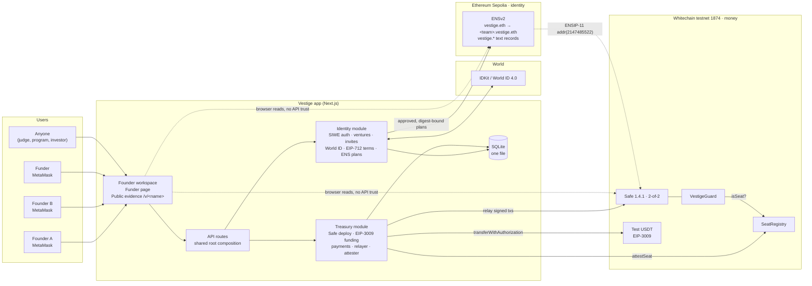
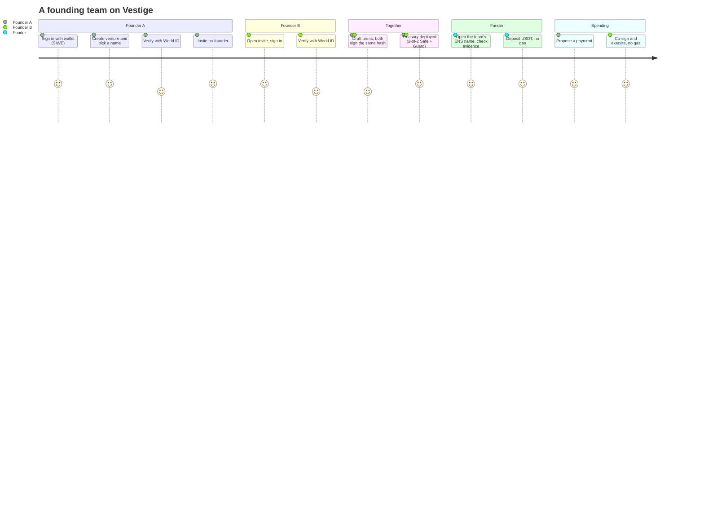
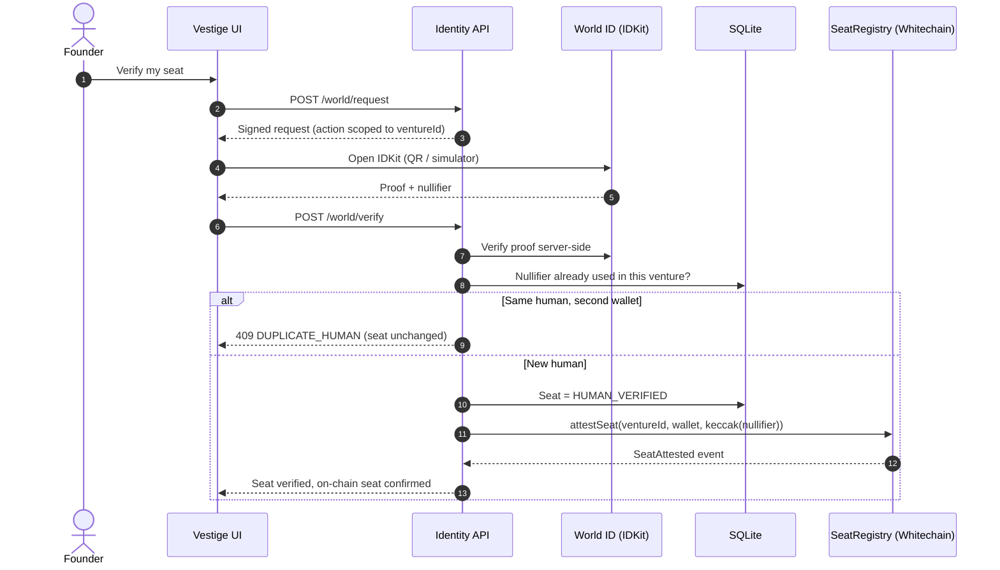
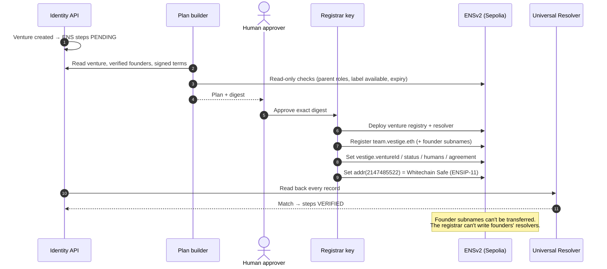
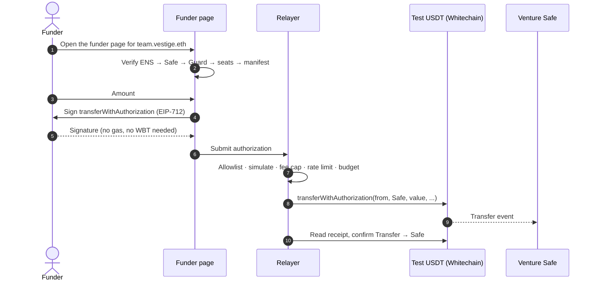
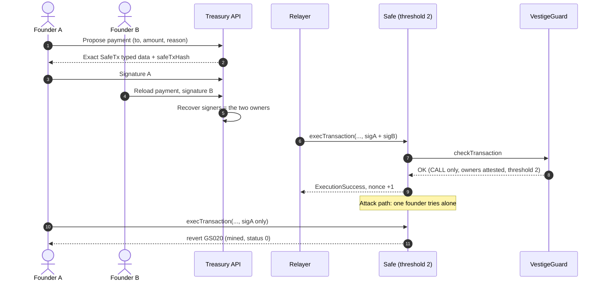
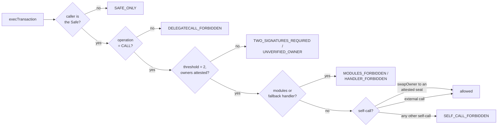
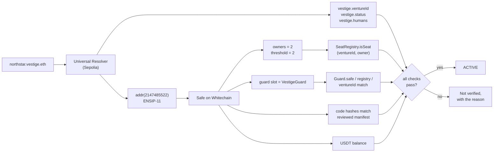
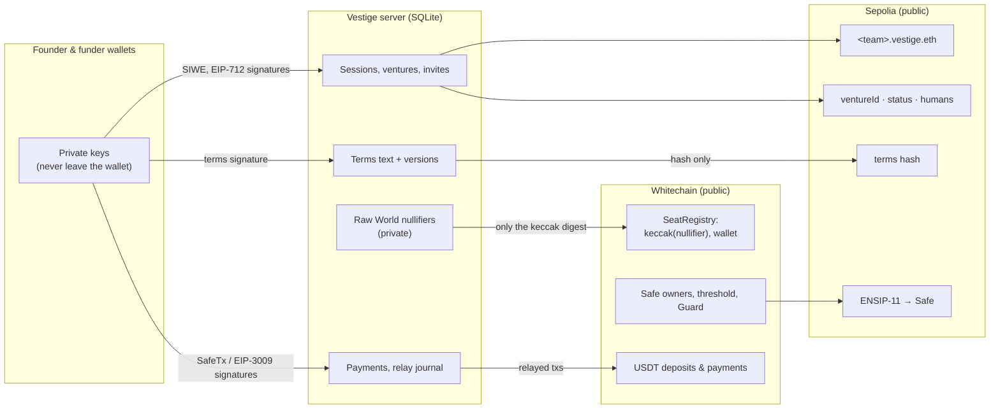
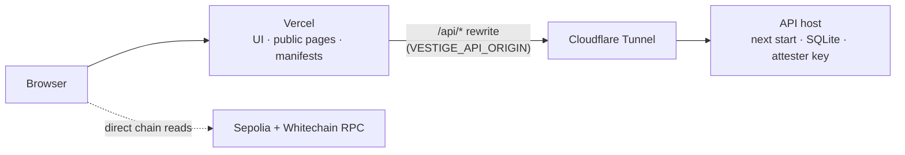

# Vestige 🪪

**Know who you're funding, from day zero.**

Vestige gives an early, unincorporated founding team one name, `<team>.vestige.eth`, that binds together everything a funder needs to trust:

- **Two distinct real humans** as founders: World ID, one seat per human per venture.
- **Signed founding terms**: one exact EIP-712 hash, signed by both founders.
- **A 2-of-2 USDT treasury** on Whitechain that no single founder can move. A Guard enforces it and only accepts verified-human seats as owners.

Anyone can verify all three from ENS and the chain, without trusting Vestige. Founders never touch gas or a seed phrase.

> A Vestige venture is a team workspace with verifiable records. **It is not a company** and confers no legal rights.

Built at **ETHGlobal Mumbai 2026** for **ENS**, **World** and **Whitechain**.

---

## 💡 Concept & Vision

> _A 2-of-2 treasury means nothing if one person holds both keys. Vestige proves the founders are two real people, binds them to signed terms, and lets every funder verify it._

### The Vision

- **Teams are verifiable from the first day**, long before there's a company, a bank account or a cap table.
- **Funders verify; they don't trust.** Every claim on a venture's page can be checked against ENS and the chain.
- **Two chains, each doing one job.** Identity lives where ENS lives (Ethereum Sepolia). Money lives where stablecoin payments are cheap and native (Whitechain). ENSIP-11 links the two, so the name is the only entry point.
- **No crypto chores for users.** Founders and funders only sign messages. Our relayer pays every Whitechain gas fee.

### Core Innovation

Multisig governance assumes the signers are different people. Nobody checks that. **Vestige checks it twice:**

1. **Off-chain:** each seat needs a World ID proof whose nullifier is scoped to the venture. The same human can't take two seats in the same venture.
2. **On-chain:** a `SeatRegistry` records verified seats, and a Safe **Guard** refuses any owner set that isn't made of attested seats. The rule is in the contract, not just in our database.

---

## 🔍 The Problem

### Today

- Hackathon prizes, grants and pre-seed cheques go to **teams that don't legally exist yet**.
- A team with no company **can't open a joint bank account**, so the money lands in one founder's personal wallet.
- A "2-of-2 multisig" can be **one person with two wallets**. Nothing on-chain can tell the difference.
- Funders have **no record** of who the founders are, what they agreed, or who controls the money.

### Pain Points We Solve

1. **Sybil founders:** one person posing as a two-person team. → World ID, one seat per human.
2. **Single point of control:** one founder can walk away with the funds. → a 2-of-2 Safe plus a Guard that only accepts verified seats.
3. **Undocumented terms:** "we agreed 50/50" exists only in a group chat. → both founders sign the same EIP-712 hash.
4. **Opaque treasuries:** funders can't see where money went. → a public evidence page built from on-chain reads only.
5. **Crypto friction:** gas, chain switching and seed phrases. → EIP-3009 gasless deposits and relayed Safe transactions.

---

## 🏗️ Architecture



**Key design rules**

- **Founders' keys never touch our backend.** Sign-in (EIP-4361), terms (EIP-712) and Safe transactions are all signed in the founder's own wallet.
- **Server roles are separate and narrow.** The registrar, attester and relayer each have their own key. Each is limited to an exact target, selector and value allowlist, with gas and fee caps. Every broadcast follows a human-approved plan bound to a digest.
- **Fail-closed public page.** `/v/<name>` never says ACTIVE from API data. It resolves ENS, follows ENSIP-11 to the Safe, then checks the owners, threshold, Guard binding, code hashes, modules, SeatRegistry and USDT against a **reviewed deployment manifest**.

---

## 👤 User Journey



### Step by step

| # | Who | Step | What happens underneath |
|---|---|---|---|
| 1 | Founder A | **Create** | SIWE sign-in. The venture gets a server `ventureId`. ENS registration is queued as a plan, never broadcast automatically. |
| 2 | Both | **Verify** | World ID proof per seat. The nullifier is scoped to the venture, so a second seat from the same human is refused (`DUPLICATE_HUMAN`). |
| 3 | Both | **Sign** | Both founders sign one EIP-712 terms hash. Any edit creates a new version and resets both signatures. |
| 4 | Operator | **Attest** | The attester writes `SeatRegistry.attestSeat(ventureId, wallet, keccak(nullifier))` on Whitechain. The raw nullifier never leaves the server. |
| 5 | Operator | **Treasury** | A Safe is created with owners = the two attested wallets, threshold 2, and VestigeGuard attached. |
| 6 | Funder | **Fund** | The funder signs an EIP-3009 `transferWithAuthorization`. The relayer submits it, so the funder spends 0 gas. |
| 7 | Founders | **Pay** | Both sign one SafeTx. The relayer executes it. A single signature is rejected on-chain (`GS020`). |
| 8 | Anyone | **Verify** | `/v/<team>.vestige.eth` reads ENS and Whitechain directly in the browser. |

---

## ⚡ Core Protocol Flows

### 1. Unique-human seats with World ID 🌍



### 2. ENS identity, with every write approved and digest-bound 🔷



### 3. Gasless funding with EIP-3009 💸



### 4. 2-of-2 payment, and the on-chain 1-of-2 refusal 🛡️



### 5. What the Guard enforces



### 6. How a funder verifies a team, with no trust in Vestige



---

## 🔄 Data Flow: what lives where



**Privacy rules:** raw World nullifiers, terms text and email/PII stay off-chain. Only digests and wallet addresses go on-chain.

---

## 🏆 Sponsor Tracks

| Sponsor | Prize | How Vestige uses it | Live proof |
|---|---|---|---|
| **ENS** | Best Use of ENSv2 | `vestige.eth` has its own ENSv2 parent registry. Each team gets an emancipated venture registry and resolver, and each founder a non-transferable subname. The `vestige.*` text records carry the venture's state. ENSIP-11 `addr(2147485522)` links the name to the Whitechain Safe. The name is the single entry point. | Sepolia receipts below; 18/18 post-deploy checks, including transfer and resolver-write refusals |
| **World** | Best Use of IDKit | World ID 4.0 per seat, with the nullifier scoped to the venture. Duplicate-human refusal on the server, and a nullifier digest attested on-chain so the Guard can enforce it. | Staging (simulator) evidence; see the honest list |
| **Whitechain** | Scale: Payments Nobody Notices | A USDT treasury on Whitechain. Deposits are gasless via EIP-3009 and payments are relayed 2-of-2 Safe transactions, so users never hold WBT. Custom `SeatRegistry` + `VestigeGuard` + `SafeSetup` contracts. | Live 10 USDT deposit, 5 USDT 2-of-2 payment, mined GS020 revert |

---

## ✅ Live On-Chain Evidence

### Whitechain testnet (1874): the money

| What | Tx / address |
|---|---|
| SeatRegistry | [`0xe91BF256…bcBA`](https://explorer.testnet.whitechain.io/address/0xe91BF256Afa7c5453e715c39Ab2431EAd492bcBA) · [deploy tx](https://explorer.testnet.whitechain.io/tx/0x4b3303aaec451196264af6ef4faf0df072d24456311c99fec98cc97b6e72d6ff) |
| SafeSetup | [`0x153406cd…1558`](https://explorer.testnet.whitechain.io/address/0x153406cd0509E71d302eD49E787051Bb98231558) · [deploy tx](https://explorer.testnet.whitechain.io/tx/0xb8f34f2b425cd80ac512ee44d7cc18f9301a25a71a2223e0a79e4334e79f4adb) |
| Seat attested: founder A (World staging digest) | [`0x4c123b4f…cec2`](https://explorer.testnet.whitechain.io/tx/0x4c123b4f9e3e4d93fb25b9abeaadb69a94a1ad1aa6c37f508bcc5bb00e29cec2) |
| Seat attested: founder B (**demo override, MOCK_ONLY**) | [`0x2d185976…28de`](https://explorer.testnet.whitechain.io/tx/0x2d1859763c7b5b621fc251e37b3d60c81b1242bdc7cb5411118be2045a7728de) |
| northstar Safe (2-of-2) + VestigeGuard | [`0xE707e3e9…23A2`](https://explorer.testnet.whitechain.io/address/0xE707e3e99Da85B0D8F3814a640976b3B08A123A2) · Guard [`0x3255A0C5…fa6B`](https://explorer.testnet.whitechain.io/address/0x3255A0C5d39167FC55b6dE917DCf6F014F6efa6B) · [creation tx](https://explorer.testnet.whitechain.io/tx/0x93ef21464c92d8a903df9b885cc4801386b39d76f9d0808bf26e8f36b9116293) |
| **Gasless deposit**, 10 USDT funder → Safe (EIP-3009, relayed) | [`0x80a0323b…ddef`](https://explorer.testnet.whitechain.io/tx/0x80a0323b7e3397135bea641644ca5c391c1c2e93d003e58b7d2fc1ce93caddef) |
| **2-of-2 payment**, 5 USDT Safe → payee (relayed) | [`0x9be37d58…d4ad`](https://explorer.testnet.whitechain.io/tx/0x9be37d5801a42dc9427325c1204db156725fa61c9948e37748cc596a532bd4ad) |
| **1-of-2 attempt, mined revert `GS020`** | [`0x7a0691c2…883a`](https://explorer.testnet.whitechain.io/tx/0x7a0691c2dd082938514418955ec40d6a39e291c682957f62a8bbd2694c82883a) |

Readback after the payment: Safe nonce 1, Safe 5 USDT, payee 5 USDT.

### Ethereum Sepolia (11155111): the identity

| What | Tx / address |
|---|---|
| `vestige.eth` ENSv2 parent registry | [`0x61Dc50fE…7Aa73`](https://sepolia.etherscan.io/address/0x61Dc50fE2099012bD1d0A684192071Ef51d7Aa73) · [deploy tx](https://sepolia.etherscan.io/tx/0x3a32aca8086f8c8bcc3d4026e98e5caea28cf921259d39e5d87d753c1b30e151) |
| `vestige.eth` subregistry set | [`0x36a8f637…5bb7`](https://sepolia.etherscan.io/tx/0x36a8f637f1fded35601eb22c06e193a9653c0d5cb529ac064f101f3c6a655bb7) |
| northstar venture registry | [`0xa11e884a…623b`](https://sepolia.etherscan.io/tx/0xa11e884ab4131b8fcb129d5f7a12a1977bc113edff9aa34c9ff582d381f9623b) |
| northstar resolver | [`0x9af16690…af9b`](https://sepolia.etherscan.io/tx/0x9af16690cf3ab772c54a155e99db4a9e23e4d442ba1140b8288e19ede2f6af9b) |
| `northstar.vestige.eth` registered | [`0x941bb725…3ab0`](https://sepolia.etherscan.io/tx/0x941bb725a2d7e7efddcc739cd7c62640d9e5e87d392fb91e9e4f490989173ab0) |
| `aman.northstar.vestige.eth` (non-transferable founder name) | [`0x282286c7…028f`](https://sepolia.etherscan.io/tx/0x282286c7c1478b1ddeec7c43fe3a71d395f8329026888f6813e5b5b28114028f) |

Live records: `vestige.ventureId = 0xe68b1b43…e3ff`, `vestige.status = workspace`, `vestige.humans = 1`.

---

## 🧾 Honest List: what is simulated or not yet live

| Area | Status |
|---|---|
| **World ID** | **Staging (simulator) only**, labelled *TESTED IN SIMULATOR* everywhere. The duplicate-human refusal is real staging evidence. No real-human production uniqueness is claimed yet. |
| **Second northstar founder** | A **demo-override seat (MOCK_ONLY)**: not World-verified, because the simulator returned the same nullifier for two test identities. Its on-chain seat hash is `keccak256("vestige.demo-override/1\|ventureId\|wallet")`, which can never collide with a World digest. It is labelled *DEMO OVERRIDE · NOT WORLD-VERIFIED* and is not counted in `vestige.humans`. The Safe, Guard and 2-of-2 rule are real. |
| **ENS → Safe link** | The ENSIP-11 record pointing `northstar.vestige.eth` at the Safe has been planned but not yet broadcast. Until it is, the public page can't reach the Safe from ENS and says so rather than showing ACTIVE. |
| **Pre-existing Safe/USDT contracts** | Their live code hashes are checked against pinned values. Their creation history is **explorer-attested** (Blockscout), because the public RPC prunes old state and disallows tracing. Everything Vestige deployed is proven from its own receipts. |
| **Relayer** | It ran in an approved, session-only mode for the deposit and payment above, then was disabled. The server relayer is off by default. |
| **Legal** | Not a company. No incorporation and no legal rights. |

---

## ⚙️ Modular Design

| Module | Path | Responsibility |
|---|---|---|
| Identity | `src/modules/identity/` | SIWE sessions, ventures, invites, World ID, EIP-712 terms, approval-gated ENS plans, reconciliation |
| Treasury | `src/modules/treasury/` | Safe deployment plans, manifests and provenance, EIP-3009 funding, payments, seat attester, v1 readback |
| Relayer | `src/modules/relayer/` | Allowlisted, simulated, fee-capped transaction submission with a durable journal |
| UI | `src/modules/ui/`, `app/`, `components/` | Founder workspace, funder page, wallet adapter |
| Public view | `src/modules/public-view/` | Browser-side ENS + Whitechain verification against the reviewed manifest |
| Contracts | `contracts/` | `SeatRegistry.sol`, `VestigeGuard.sol`, `SafeSetup.sol` (Foundry) |
| Composition | `src/shared/composition.ts` | Wires the modules over one SQLite connection |

### Key parameters

```text
Identity chain        Ethereum Sepolia        11155111
Money chain           Whitechain testnet      1874
ENSIP-11 coin type    0x80000000 | 1874   =   2147485522
Safe                  v1.4.1 L2, threshold 2, exactly 2 owners, no modules, no fallback handler
Token                 Test USDT (6 decimals, EIP-2612 + EIP-3009)
Attester              attestSeat only · ≤120k gas · max fee 10 gwei
```

---

## 🚀 Deployment



- **Vercel** serves the app, the public evidence pages and the reviewed manifests. Because the browser stays on one origin, SIWE origin checks and cookies work unchanged.
- **The API host** keeps the SQLite state and the server-only keys. Set `VESTIGE_API_ORIGIN` on Vercel to its URL and every `/api/*` call is proxied there.
- Public evidence pages read the chain directly, so they keep working even if the API host is down.

## 🧪 Quick Start

```bash
pnpm install
cp .env.example .env.local      # VESTIGE_DB_PATH, VESTIGE_AUTH_URI, RPC URLs, World RP config
pnpm build && pnpm start        # http://localhost:3200
open http://localhost:3200/v/northstar.vestige.eth
```

```bash
pnpm typecheck
pnpm test                                                   # unit
pnpm exec vitest run -c tests/e2e/cross-owner/vitest.config.ts   # cross-module, real handlers
npm test --prefix src/modules/treasury                      # treasury + relayer
forge test                                                  # contracts
```

---

## 📊 Project Status

| Never-cut demo item | Status |
|---|---|
| A fresh venture created live | ✅ `northstar.vestige.eth` + attested seats + Safe |
| Duplicate-human refusal | ✅ World staging (simulator) |
| On-chain 1-of-2 revert | ✅ mined `GS020` |
| ENS-resolved public evidence | 🟡 ENS records live; ENSIP-11 Safe link pending |

## 🗺️ Roadmap

- **Production World ID** with real founders at the next cohort.
- **ENSIP-11 treasury records** set at venture creation.
- **Program dashboard** for builder programs: cohort view, milestone payments, sponsored gas allowance.
- **Mainnet** on Whitechain and Ethereum after an audit of `VestigeGuard` and `SeatRegistry`.

